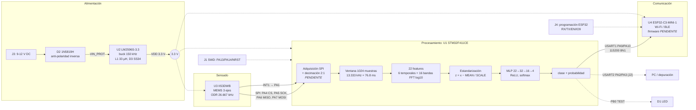
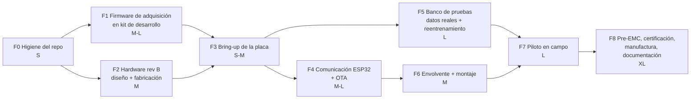

# Guía del proyecto AI-SED PCB

**Para:** Moro (Juan Alfonso Moroyoqui Delgadillo) y el equipo ITESCA PCB Lab.
**Objetivo de este documento:** que entiendas a fondo qué se hizo en cada fase del repositorio, por qué se hizo así, qué está verificado y qué no, y cuál es el camino concreto para llevar la placa desde "proyecto de concurso" hasta **producto final**.

**Base:** revisión completa del repositorio (rama `claude/inspiring-galileo-81ysf9`, último commit `a257b3f`, 7-nov-2026), del documento del concurso en `docs/`, de los Gerber, del netlist y de los binarios. Cada afirmación lleva su ruta de archivo. Lo que no está en el repo va marcado como **[Supuesto]** o **[Verificar]**.

---

## Índice

1. [Resumen ejecutivo](#1-resumen-ejecutivo)
2. [Arquitectura del sistema](#2-arquitectura-del-sistema)
3. [Fases del proyecto (cronología real)](#3-fases-del-proyecto-cronología-real)
4. [Verificación de coherencia: inconsistencias, bugs y riesgos](#4-verificación-de-coherencia-inconsistencias-bugs-y-riesgos)
5. [Brechas para llegar a producto final](#5-brechas-para-llegar-a-producto-final)
6. [Roadmap hacia producto final](#6-roadmap-hacia-producto-final)
7. [Glosario](#7-glosario)
8. [Anexo: cómo reproducir lo que se verificó](#8-anexo-cómo-reproducir-lo-que-se-verificó)

---

## 1. Resumen ejecutivo

**Qué es.** AI-SED PCB es una placa de 2 capas y 5 × 5 cm que se monta sobre la carcasa de un motor (o una bomba, un ventilador o un compresor). Mide vibración con un acelerómetro digital MEMS (IIS3DWB) y un microcontrolador STM32F411CE ejecuta ahí mismo una red neuronal pequeña que clasifica el rodamiento en **sano, pista interna, bola o pista externa**. Un módulo ESP32-C3 envía solo el diagnóstico por Wi-Fi o BLE (`README.md`, `docs/Embedded-AI PCB ... .pdf` §2-3).

**Qué problema resuelve.** Las fallas de rodamiento son una causa principal de paros no planeados. Los sistemas comerciales de monitoreo de condición cuestan unos US$275 por nodo (Fluke 3561 FC, según el PDF §6.3). La placa busca hacer el diagnóstico **en el borde** (edge AI) por unos US$17-41 de componentes, sin nube ni suscripción. En vez de transmitir unos 160 KB/s de datos crudos, transmite una clase y una confianza por cada ventana de 77 ms (PDF §5.1).

**Estado actual (verificado en esta revisión):**

| Área | Estado | Evidencia | ¿Lo verifiqué yo? |
|---|---|---|---|
| Esquemático | Hecho | `docs/esquematico_AI-SED.png`, `hardware/proteus/AI-SED-PCB.pdsprj` | Revisado visualmente y contra el netlist |
| PCB ruteada (2 capas, 50 × 50 mm) | Hecho: 0 DRC, PPC con 28/28 pruebas aprobadas | `hardware/gerber/... READ-ME.TXT` (líneas 134-137), `Profile.GBR` (±25 mm) | Sí, con datos de los Gerber |
| Gerber + taladros + netlist IPC-D-356 | Hecho | `hardware/gerber/` (12 archivos) | Sí: 70 taladros, 47 vías, sin agujeros de montaje |
| BOM | Hecho a nivel de concepto: 31 piezas en 19 líneas; pasivos sin número de parte | `hardware/bom/BOM_AI-SED-PCB.csv` | Sí (cuenta correcta) |
| Modelo TinyML (MLP 22-32-16-4, float32) | Entrenado con CWRU; 100 % en la carga de 3 HP | `model/` | Revisé el código y la matriz de confusión. No pude reentrenar (no están los datos CWRU) |
| Pipeline de inferencia en C | Hecho | `firmware/src/ai_pipeline.c/.h` | **Sí: compila con gcc sin warnings y da 16/16 en el host** |
| Firmware demo bare-metal | Hecho (ventanas CWRU guardadas en flash) | `firmware/app/` | **Sí: `ai_sed.elf` y `ai_sed_proteus.elf` dan 16/16 en Unicorn** |
| Driver SPI del IIS3DWB, adquisición real, decimación | **No existe** | — | — |
| Firmware del ESP32-C3 | **No existe** | — | — |
| Configuración de reloj a 100 MHz | **No existe**: el firmware corre a 16 MHz (HSI) | `firmware/app/main.c:36` | Sí |
| Placa fabricada / validación en motor real | **No** | PDF §7 | — |
| Consistencia del modelo | **Problema:** los pesos del firmware NO son los del `.tflite`/`.h5` | ver §4, I-1 | Sí, comparación binaria |

**En una frase:** el diseño electrónico y la cadena de IA están completos y verificados **en simulación y con datos de laboratorio**. Para ser producto faltan cuatro cosas: la adquisición real del sensor, las comunicaciones, el hardware físico (con correcciones) y la validación con máquinas reales.

---

## 2. Arquitectura del sistema

### 2.1 Diagrama de bloques



### 2.2 Flujo de datos, paso a paso

| Paso | Qué ocurre | Dónde está en el repo | Estado |
|---|---|---|---|
| 1. Sensado | El IIS3DWB muestrea a 26.667 kHz en 3 ejes, 16 bits, con un ancho de banda de unos 6 kHz | Pines en el netlist `hardware/gerber/...Netlist.IPC` | Hardware listo, driver pendiente |
| 2. Decimación 2:1 | 26.667 → 13.333 kHz, para igualar la tasa con la que se entrenó el modelo | `firmware/README.md:8` ("still to do") | **Pendiente** |
| 3. Ventaneo | 1024 muestras (76.8 ms), con 50 % de traslape en el entrenamiento | `model/modeloCWRU_corregido.py:22` | En C, `AI_WIN` (`ai_pipeline.h:18`) |
| 4. Features | Se resta la media; RMS, pico, factor de cresta, curtosis, asimetría y desviación estándar; FFT con ventana Hann; log10 de la energía en 16 bandas de 32 bins | `modeloCWRU_corregido.py:32-38`, `ai_pipeline.c:151-180` | Verificado: el C coincide con numpy |
| 5. Normalización | `(x - MEAN) / SCALE` con el StandardScaler del entrenamiento | `modelo_pesos.h` (MEAN/SCALE), `ai_pipeline.c:187` | OK |
| 6. Inferencia | MLP 22-32-16-4 con 1,332 parámetros en float32 (unos 5.3 KB) | `ai_pipeline.c:183-218` | OK |
| 7. Salida | Texto por USART1 (que llega al ESP32 y a J4) | `firmware/app/main.c` | Demo; falta definir el protocolo |

### 2.3 Números clave (calculados desde el código)

- Resolución espectral: `fs / N = 13 333 / 1024 ≈ 13.02 Hz` por bin.
- Ancho de cada banda: 32 bins × 13.02 Hz ≈ **416.7 Hz**. La banda 1 cubre unos 13-417 Hz y la 16 unos 6 250-6 667 Hz.
- Duración de la ventana: 1024 / 13 333 ≈ **76.8 ms**. Con 50 % de traslape sale una ventana nueva cada unos 38 ms.
- Coste de una inferencia, medido en el emulador: unas **211 000 instrucciones** por `ai_diagnose()` en régimen (la primera llamada son unas 391 000 porque construye las tablas). Con la FPU deshabilitada (build de Proteus) son unos 2.7 millones. **[Supuesto]** Con un CPI de 1-2 eso equivale a unos 2-4 ms a 100 MHz, o a unos 13-26 ms a los 16 MHz actuales. Cabe con holgura en 38 ms, pero hay que **medirlo en la placa real**.
- Pila máxima medida en el emulador: unos **12.6 KB**, por los buffers `w[1024]`, `re[1024]` e `im[1024]` en la pila. La RAM es de 128 KB.
- Flash del firmware demo: unos 78 KB. De eso, **64 KB son las 16 ventanas de prueba** (`TEST_WIN`) y el modelo con el código ocupa unos 14 KB. La RAM estática (`.bss`) es de 8.5 KB: tablas Hann, cos y sin.

---

## 3. Fases del proyecto (cronología real)

Reconstruí la cronología con `git log --stat --reverse` (32 commits, todos del 7-nov-2026 hechos con la carga web de GitHub), con las marcas de tiempo internas de los `.pdsprj` y con el historial de ProPilot (el asistente de IA de Proteus) que quedó guardado en `AI-SED-PCB.pdsprj/SCRIPTS/PROPILOT.XML`.

| # | Fase | Fecha / commit | Archivos principales |
|---|---|---|---|
| 0 | Librería del IIS3DWB y captura del esquemático | 6-nov (dentro del zip) | `hardware/library/Libreria_IIS3DWB.pdsprj` |
| 1 | Revisión del esquemático y colocación (con ProPilot) | 6-nov 05:12-15:35 | `PROPILOT.XML` dentro del `.pdsprj` |
| 2 | PCB ruteada con DRC limpio + repositorio | 7-nov 03:42, `8469020` | `README.md`, `hardware/proteus/AI-SED-PCB.pdsprj`, `docs/placa_ruteada.png` |
| 3 | Modelo de IA corregido (13.3 kHz) | 7-nov 10:41, `5dc1542` | `model/*` |
| 4 | Gerber (fabricación) | 7-nov 17:47-17:58, `8253f5f` → `06d3b9f` → `50f7901` (PR #1) | `hardware/gerber/*` |
| 5 | Pipeline de inferencia en C + test de host | 7-nov 18:26, `b80225e` (PR #2) | `firmware/src`, `firmware/include`, `firmware/test` |
| 6 | Firmware bare-metal + emulación + Proteus VSM | 7-nov 20:21, `0bc9f07` | `firmware/app/*` |
| 7 | Documentación, BOM y documento del concurso | 7-nov 20:22-23:16 | READMEs, `hardware/bom/*`, `docs/*` |

> Nota sobre el historial: en `8253f5f` los Gerber y una copia de los `.pdsprj` se subieron por error a `hardware/hardware/`. Se borraron en `06d3b9f` y se volvieron a subir bien en `50f7901`. Los README se renombraron varias veces (`readme` → `README.MD`). Conviene acostumbrarse a hacer commits desde git local y no con "Add files via upload": los mensajes se vuelven más útiles y estos accidentes se evitan.

---

### Fase 0-1: Librería del sensor y esquemático

**Objetivo.** Tener en Proteus un símbolo y un footprint del IIS3DWB, que no viene en la librería estándar, y capturar el esquemático completo.

**Qué se hizo.**
- `hardware/library/Libreria_IIS3DWB.pdsprj`: proyecto de librería con el símbolo y el footprint LGA-14 (2.5 × 3 mm, paso 0.5 mm). Según el PDF §3.2 se hizo a partir del datasheet y de la nota técnica ST TN0018 (soldadura de MEMS). Los pads en los Gerber son de 0.35 × 0.575 mm (aperturas D24/D25 en `READ-ME.TXT`).
- Esquemático (`docs/esquematico_AI-SED.png`), con cuatro bloques:
  - **U1 STM32F411CE** (UFQFPN48): BOOT0 a GND con RBOOT 10 k, VCAP_1 con CV 4.7 µF, NRST con C_NRST 100 nF, VDDA con 100 nF + 1 µF, tres capacitores de 100 nF en VDD, VBAT directo a 3.3 V. **Sin cristal**: PH0 y PH1 quedan libres, así que el reloj sale del oscilador interno HSI.
  - **U3 IIS3DWB**: SPI de 4 hilos y INT1 a PA1. INT2 queda abierto a propósito (PDF §3.3). Lleva dos capacitores de 100 nF cerca.
  - **U4 ESP32-C3-MINI-1-N4**: EN con pull-up de 10 k (R_EN), IO2 con pull-up de 10 k, RXD0/TXD0 cruzados con USART1 del STM32 e IO9 al conector J4 para el modo de descarga.
  - **Potencia**: J3 → D2 (1N5819H en serie) → LM2596S-3.3 → L1 de 33 µH, D3 SS34, CIN 680 µF, COUT 470 µF y C1 de 10 µF.
- Revisión con ProPilot (6-nov): la IA de Proteus detectó pines sin conectar. En esa versión **INT1 del sensor aún no estaba conectado**; en la versión final ya va a PA1 (netlist: `SENS_INT1 = U1-11, U3-4`).

**Decisiones técnicas y por qué.**
| Decisión | Razón |
|---|---|
| Sensor **digital** IIS3DWB en lugar de un piezo o un MEMS analógico + ADC | No hace falta front-end analógico, hay menos ruido, tiene un ancho de banda de unos 6 kHz y es de grado industrial |
| STM32F411 (Cortex-M4F) | Tiene FPU y DSP para la FFT y la red en float32, 512 KB de flash y 128 KB de RAM, y es barato (unos US$3.7 en LCSC, PDF §6.1) |
| ESP32-C3-MINI-1 como módulo | Ya viene pre-certificado (radio), así que no hay que diseñar RF |
| LM2596 (buck) en vez de LDO | Bajar de 12 V a 3.3 V con un LDO disiparía (12-3.3) × I. Con picos de Wi-Fi de cientos de mA eso es demasiado calor |
| Diodo Schottky en serie (D2) | Protege contra la polaridad invertida con una caída de unos 0.4 V |

**Conceptos que debes dominar.**
- **Desacoplo:** cada pin de alimentación de un CI lleva un capacitor de 100 nF lo más cerca posible. Suministra la corriente de los picos de conmutación para que el ruido no viaje por el plano de alimentación. El de 1 µF a 4.7 µF ("bulk") cubre transitorios más lentos.
- **VCAP_1:** el STM32F4 tiene un regulador interno de 1.2 V para el núcleo, y ese regulador **necesita** un capacitor externo (4.7 µF de bajo ESR según el datasheet) para ser estable. Si falta o es incorrecto, el micro no arranca o se reinicia.
- **BOOT0:** se lee al salir del reset. Con 0 arranca desde la flash de usuario; con 1 arranca el *bootloader de sistema* de ST (UART/USB/I²C/SPI). Aquí está fijo a 0 con resistencia.
- **Pines de *strapping* del ESP32-C3:** IO2, IO8 e IO9 se leen al arrancar y deciden el modo (SPI boot normal o descarga por UART). Ver el riesgo R-4 en §4.
- **SPI (Serial Peripheral Interface):** bus síncrono maestro-esclavo con CS (selección, activo en bajo), SCK (reloj), MOSI (del maestro al esclavo) y MISO (del esclavo al maestro). El IIS3DWB acepta SPI de hasta 10 MHz **[Verificar en el datasheet]**, en modo 0 o 3.
- **Interrupción de "data ready" / FIFO:** en lugar de preguntar continuamente (polling), el sensor avisa por INT1 cuando hay datos o cuando la FIFO llegó al umbral.

**Preguntas de autoevaluación.**
1. ¿Qué pasaría si quitas CV (VCAP_1)? ¿Y si BOOT0 quedara flotando?
2. ¿Por qué el diodo de protección (D2) es Schottky y no un 1N4007? ¿Qué tensión llega realmente al LM2596 con 9 V de entrada?
3. Sin cristal externo, ¿qué precisión tiene el HSI y qué afecta: el UART, el muestreo o ambos? (Pista: el muestreo lo marca el reloj interno del sensor.)
4. ¿Qué combinación de IO8 e IO9 pone al ESP32-C3 en modo de descarga?

---

### Fase 2: Layout de la PCB (ARES)

**Objetivo.** Colocar y rutear en 2 capas con buena integridad de señal y EMI, y pasar DRC y Pre-Production Check.

**Qué se hizo** (commit `8469020` "Diseño inicial: PCB ruteada, DRC limpio" y `docs/placa_ruteada.png`, `pcb_top.png`, `pcb_bottom.png`):
- Tablero de **50 × 50 mm**. El `Profile.GBR` es un cuadrado de −25 a +25 mm.
- Todos los componentes en la capa superior. La inferior lleva un **plano de tierra** (copper pour hecho con el Power Plane Generator), con algunas pistas que lo cruzan.
- Pistas de 0.254 mm (señal) y de 0.508 o 0.762 mm (potencia). Vías con pad de 0.762 mm y taladro de 0.381 mm (`READ-ME.TXT` D10-D13, D102).
- Holguras: pad-pad 0.127 mm (5 mil), pista-pista 0.152 mm, cobre-borde 0.38 mm (PDF §3.2).
- Ubicación (coordenadas sacadas del netlist): U1 en el centro (0, 0) mm, U3 a la derecha (14.8, −1.3), U4 arriba (−6..6, 7.5..17.5) con la antena hacia el borde superior, y la etapa de potencia abajo (U2 en (1.3, −15), L1 en (10, −20), D3 en (10, −10)).
- Resultado: 0 sin rutear, 0 errores DRC y PPC con 28 pruebas aprobadas (`READ-ME.TXT:134-137`).

**Decisiones técnicas y por qué.**
- **Sensor a unos 1.5 cm del MCU:** el SPI queda corto.
- **Conmutación lejos del sensor y de la antena:** el nodo SW del buck (150 kHz, flancos rápidos) es la principal fuente de EMI de la placa, y el lazo de conmutación (CIN → U2 → D3) debe ser pequeño.
- **Antena del ESP32 en el borde, con keepout de cobre:** el cobre debajo de una antena PCB la desintoniza y baja el alcance. Ver la inconsistencia I-5: la capa inferior **sí** tiene cobre en esa zona según el Gerber.
- **Pasivos 0805:** fáciles de soldar a mano en prototipos.

**Conceptos que debes dominar.**
- **DRC (Design Rule Check)** frente a **PPC (Pre-Production Check)**: el DRC revisa holguras y anchos; el PPC de Proteus revisa además que la placa sea fabricable (bordes, capas, taladros, etc.).
- **Plano de tierra:** da un retorno de baja impedancia justo debajo de cada pista. Cada pista que lo corta obliga a la corriente de retorno a rodear el corte, lo que forma un lazo y aumenta la emisión. En el Gerber inferior hay **24 regiones** de cobre: el plano está fragmentado.
- **IPC-2221** (ancho de pista contra corriente y holguras) e **IPC-7351** (land patterns).
- **Máscara de soldadura entre pads finos:** con un paso de 0.5 mm queda una franja de unos 0.05 mm, que muchos fabricantes no pueden producir. Por eso el README pide avisar al fabricante.

**Preguntas de autoevaluación.**
1. ¿Por qué cortar el plano de tierra con una pista larga es peor que poner una vía y pasar la pista por arriba?
2. Dibuja el lazo de corriente de alta di/dt de un buck. ¿Qué componentes deben quedar más juntos?
3. ¿Qué ancho de pista necesitas para 1 A con cobre de 18 µm y con cobre de 35 µm? (Ver la inconsistencia I-7.)

---

### Fase 3: Modelo de IA (TinyML) con CWRU

**Objetivo.** Entrenar un clasificador de fallas pequeño que **coincida con la frecuencia de muestreo y las condiciones del sensor real**.

**Qué se hizo** (commit `5dc1542`, "Se corrigió el modelo para que encajara en el diseño del pcb a 13.3kHz"):
- `model/modeloCWRU_corregido.py` (112 líneas). Es una **versión corregida** de un `modeloCWRU.py` original que **no está en el repo**:
  1. **Datos:** CWRU (Case Western Reserve University), acelerómetro del lado de accionamiento (drive end), a 12 kHz, fallas de 0.007". Archivos 97-100 (sano), 105-108 (pista interna), 118-121 (bola) y 130-133 (pista externa). El índice dentro de cada lista es la carga: 0, 1, 2 o 3 HP (líneas 23-24).
  2. **Corrección de carga de datos:** se busca la clave `X%03d...DE_time` por número de archivo, porque `99.mat` también traía las claves de 98 (línea 29).
  3. **Remuestreo** de 12 kHz a 13.333 kHz con `resample_poly(x, 10, 9)` (línea 30). El objetivo es que el modelo vea **la misma tasa** que tendrá el sensor después de diezmar 26.667 kHz entre 2.
  4. **Ventanas** de 1024 con paso de 512 (50 % de traslape).
  5. **22 features** (líneas 32-38): RMS, pico, factor de cresta, curtosis, asimetría, desviación estándar y `log10(energía)` de 16 bandas del espectro con ventana Hann. **Corrección clave:** la energía de bandas pasó de escala lineal a **logarítmica**, para que el ruido no la "dispare".
  6. **Aumento de datos** (línea 54): 8 combinaciones de SNR (sin ruido, 20, 10 o 5 dB) y ganancia (×0.5, ×0.7, ×1.5, ×2).
  7. **Entrenamiento** (líneas 61-80): StandardScaler, pesos de clase "balanced" y Keras con Dense(32, ReLU) → Dense(16, ReLU) → Dense(4, softmax), Adam, 40 épocas y batch de 64. Si no hay TensorFlow usa sklearn `MLPClassifier`.
  8. **Validación:** *leave-one-load-out* (dejar una carga fuera, líneas 85-88) y entrenamiento final con 0-2 HP y prueba con 3 HP (líneas 89-93).
  9. **Robustez** (líneas 94-96): prueba con 3 HP a SNR de 20, 10, 5 y 0 dB y con ganancias de ×0.5 y ×2.
  10. **Exportación:** `scaler_corregido.npz`, `.h5`, `.tflite` y `modelo_pesos.h` (arreglos C `static const float`).
- `model/matriz_confusion_corregida.png`: con 3 HP la diagonal es perfecta. 1052 sano, 265 pista interna, 262 bola y 264 pista externa, en total **1,843 ventanas al 100 %**.
- `model/explicador.html`: página interactiva didáctica (señal → ventanas → features → efecto del ruido → efecto de fs) con la tabla de "antes y después":

| Prueba (3 HP) | Antes (12 kHz, lineal) | Después (corregido) |
|---|---|---|
| Datos limpios | 100 % | 100 % |
| Ruido 20 / 10 / 5 dB | 14 % | 100 % |
| Ruido 0 dB (no entrenado) | 14 % | 98.9 % |
| Ganancia ×0.5 | 44 % | 100 % |
| Ganancia ×2 | 88 % | 99.9 % |
| Señal a 26.7 kHz sin ajustar | 71 % | (se usa 13.3 kHz) |

- `model/scaler_corregido.npz` (lo inspeccioné): `mean` (22,), `scale` (22,), `fs = 13333.33`, `win = 1024`. Coincide con MEAN/SCALE de los dos `modelo_pesos.h` (diferencia < 5e-9).
- `model/modelo_rodamientos_corregido.h5`: Keras `Sequential` (dense_9/10/11), Adam con lr 0.001. El `.tflite` (7,580 B, cabecera `TFL3`) es **float32, sin cuantizar**.

**Decisiones técnicas y por qué.**
- **Features "a mano" + MLP en vez de una CNN sobre la señal cruda:** 1,332 parámetros (unos 5 KB) frente a decenas de miles. Es fácil de portar a C sin librerías y su comportamiento se puede explicar.
- **log10 de la energía:** el ruido blanco suma energía casi constante en todas las bandas. En escala lineal, las bandas de alta frecuencia (que en un rodamiento sano casi no tienen energía) se multiplican por miles; en log el cambio es aditivo y pequeño.
- **Aumento con ruido y ganancia:** simula que el sensor real tendrá otro ruido de fondo y otra sensibilidad o acoplamiento mecánico.
- **Pesos de clase:** "sano" tiene unas 4 veces más ventanas (el archivo de 3 HP sano es más largo), y sin pesos el modelo tiende a sesgarse hacia esa clase.
- **Prueba con una carga no vista:** es la forma de medir generalización a una condición nueva y no solo memorización.

**Conceptos que debes dominar (explicación didáctica).**
- **RMS (Root Mean Square, valor eficaz):** `sqrt(media(x²))`. Mide qué tanta "energía" tiene la vibración. Sube con desbalance, desalineación y desgaste general.
- **Pico y factor de cresta:** el pico es `max|x|` y el factor de cresta es `pico / RMS`. Una señal senoidal tiene cresta de unos 1.41; los **impactos** de una falla de rodamiento (la bola golpea la grieta) crean picos breves y la cresta sube.
- **Curtosis (kurtosis):** mide lo "picuda" que es la distribución, o qué tan pesadas son sus colas. Para ruido gaussiano vale 0 si se usa la curtosis "en exceso" (como en scipy: `m4/m2² − 3`). Los impactos periódicos la hacen muy positiva. Es el indicador clásico de fallas incipientes.
- **Asimetría (skewness):** `m3 / m2^1.5`, que mide si la señal es asimétrica respecto a su media.
- **Desviación estándar:** como la media ya se restó, **es idéntica al RMS** (ver I-6).
- **FFT (Fast Fourier Transform):** convierte la señal del tiempo a la frecuencia. Con N = 1024 y fs = 13.33 kHz tienes 513 bins de 0 a 6.67 kHz, separados 13 Hz.
- **Ventana Hann:** multiplica la ventana por una "campana" para que los extremos valgan 0. Sin ella, el corte brusco produce **fuga espectral** (*leakage*), es decir, energía falsa repartida en todos los bins. `numpy.hanning` usa `N−1` en el denominador y el C lo replica (`ai_pipeline.c:71`).
- **Energía por bandas:** se suman |X|² de 32 bins consecutivos. Es una "huella" espectral compacta.
- **Frecuencias de falla de rodamiento** **[dato público del CWRU, no está en el repo]**: BPFO ≈ 3.585·fr, BPFI ≈ 5.415·fr y BSF ≈ 4.714·fr, donde fr es la frecuencia de giro (≈ 30 Hz a 1797 rpm). Eso da unos 107 Hz, 162 Hz y 141 Hz. **Todas caen en la banda 1 (13-417 Hz).** El modelo, por tanto, no "ve" esas frecuencias directamente: decide sobre todo por la energía de las **resonancias estructurales** que los impactos excitan (bandas altas) y por la impulsividad (curtosis y cresta). Es válido, pero esas resonancias **dependen de la máquina y del montaje** (ver §5, B-6).
- **Remuestreo polifásico (`resample_poly`):** sube ×10, filtra con un pasa-bajos FIR y baja ÷9. El filtro antialiasing va incluido.
- **Estandarización (StandardScaler):** `z = (x − media) / desviación`, para que todas las features tengan una escala parecida. Sin esto, la que tenga valores más grandes domina el entrenamiento.
- **MLP, ReLU y softmax:** cada capa calcula `y = W·x + b`. ReLU (`max(0, ·)`) da la no linealidad. Softmax convierte los 4 números finales en probabilidades que suman 1.
- **Entropía cruzada + Adam:** la entropía cruzada es la función de pérdida de clasificación y Adam es el optimizador por gradiente con tasa adaptativa.
- **Matriz de confusión, precisión, recall y F1:** las filas son la clase real y las columnas la predicha. La precisión responde "de lo que dije falla, ¿cuánto era falla?"; el recall, "de las fallas reales, ¿cuántas detecté?".
- **Cuantización:** convertir pesos y activaciones de float32 a int8 reduce memoria unas 4 veces y acelera en micros sin FPU. **Aquí no se hizo y no hace falta**: el modelo pesa 5 KB y el M4F tiene FPU. Sería relevante si se migrara a un micro sin FPU o a un modelo más grande (TFLite Micro con int8 o CMSIS-NN).

**Preguntas de autoevaluación.**
1. ¿Por qué entrenar a 12 kHz y luego alimentar el modelo con datos a 26.7 kHz baja la exactitud al 71 %? (Pista: ¿a qué frecuencias corresponde cada banda en cada caso?)
2. Si el sensor real tiene el doble de sensibilidad, ¿qué features cambian y cuáles no? ¿Por qué el aumento con ganancia ayuda?
3. ¿Por qué el 100 % en CWRU no garantiza el 100 % en tu motor? (Lee Smith & Randall 2015, ref. [2] del PDF.)
4. Calcula a mano cuántos parámetros tiene 22-32-16-4.
5. ¿Qué features son redundantes en este conjunto?

---

### Fase 4: Gerber y archivos de fabricación

**Objetivo.** Generar el paquete que se manda al fabricante (JLCPCB, PCBWay, etc.).

**Qué se hizo** (commits `8253f5f` → `06d3b9f` → `50f7901`, PR #1). Hay 12 archivos en `hardware/gerber/`, generados por Proteus 9.02 el 7-nov a las 17:09 **desde el proyecto `AI-SED-autorouter.pdsprj`** (`READ-ME.TXT:6`):

| Archivo | Para qué sirve |
|---|---|
| `Top Copper.GBR` / `Bottom Copper.GBR` | Cobre de cada capa (X2, mm). La capa inferior tiene el plano de tierra (24 regiones G36) |
| `Top/Bottom Solder Resist.GBR` | Máscara de soldadura (dónde **no** hay barniz verde) |
| `Top SMT Paste.GBR` | Esténcil de pasta para el ensamblaje SMT (solo arriba: todo SMD está en la capa superior) |
| `Top Silk Screen.GBR` | Serigrafía (referencias) |
| `Top Assembly.GBR` | Dibujo de ensamblaje (no se fabrica, es documentación) |
| `Profile.GBR` | Contorno del tablero: 50 × 50 mm |
| `Drill TOP-BOT Plated.GBR` | Taladros metalizados: **47 vías de 0.381 mm**, 17 de 1.016 mm (headers), 4 de 0.762 mm y 2 de 1.041 mm, **70 en total** |
| `Drill TOP-BOT Filled and Plated.GBR` | Vacío (no hay vías rellenas) |
| `Netlist.IPC` | Netlist IPC-D-356A para el *test eléctrico* del fabricante (flying probe) |
| `READ-ME.TXT` | Aperturas, stack-up (FR4 de 1.55 mm, cobre de 0.018 mm por capa) y resultado del PPC |

Resumen del netlist (las nets principales, extraídas del IPC):

| Net | Conecta |
|---|---|
| GND | U1-8/23/35/47, U2-3/5/6, U3-2/3/6/7/10/11, U4 (GND + 9 pads térmicos 49_x), J1-5, J2-3, J3-2, J4-1, todos los capacitores |
| VDD (3.3 V) | U1-1/9/24/36/48, U3-5/8, U4-3, L1-2, COUT+, J1-1, R_EN, R_IO2 |
| VIN → VIN_PROT | J3-1 → D2 → U2-1, CIN+, C1 |
| SW | U2-2, L1-1, D3-C |
| SPI_CS / SCK / MISO / MOSI | U1-14/15/16/17 ↔ U3-12/13/1/14 |
| SENS_INT1 | U1-11 (PA1) ↔ U3-4 |
| USART1_TX / RX | U1-30 (PA9) → U4-30 (RXD0), J4-3 / U1-31 (PA10) ← U4-31 (TXD0), J4-2 |
| UART_TX / RX | U1-12/13 (PA2/PA3) ↔ J2-1/2 |
| SWDIO / SWCLK / NRST | U1-34/37/7 ↔ J1-2/3/4 |
| TEST | U1-18 (PB0) → RLED → D1 |
| ESP_EN / ESP_IO9 | U4-8 / U4-23 ↔ J4-4 / J4-5 |
| Sin conexión (N/C) | U1-49 (**pad expuesto del STM32**), U3-9 (INT2), U4-22 (**IO8**) y otros GPIO |

**Conceptos que debes dominar.**
- **Gerber RS-274X / X2:** formato vectorial, un archivo por capa. X2 añade atributos (`%TF.FileFunction,Copper,L1,Top*%`) para que el fabricante sepa qué es cada archivo. `%FSLAX45Y45*%` significa 4 enteros y 5 decimales en mm.
- **Aperturas (D-codes):** "pinceles" (un círculo de 0.254 mm para pistas, rectángulos para pads). D01 dibuja, D02 mueve y D03 "estampa" (flash).
- **Regiones G36/G37:** polígonos rellenos (pours). `%LPC%` es la polaridad *clear*: borra cobre (holguras alrededor de pistas).
- **Archivo de taladros:** aquí viene en formato Gerber. Muchos fabricantes prefieren **Excellon**; Proteus puede exportar ambos.
- **IPC-D-356:** lista de cada pad con su net y coordenadas. El fabricante la usa para probar continuidad y aislamiento de la placa desnuda.

**Preguntas de autoevaluación.**
1. ¿Qué archivos son imprescindibles para fabricar la placa desnuda y cuáles para el ensamblaje (PCBA)?
2. ¿Por qué no hay "Bottom Paste"?
3. ¿Cuántos agujeros de montaje tiene la placa? ¿Cómo se fijaría al motor? (Ver B-9.)

---

### Fase 5: Pipeline de inferencia en C

**Objetivo.** Reproducir **exactamente** en C99 lo que hace Python: features y red neuronal, sin memoria dinámica, portable al PC (para probar) y al STM32.

**Qué se hizo** (commit `b80225e`, PR #2):
- `firmware/src/ai_pipeline.h`: la API `ai_features()`, `ai_classify_features()` y `ai_diagnose()`, más las constantes `AI_WIN=1024`, `AI_N_FEAT=22`, `AI_N_BANDS=16` y `AI_N_CLASSES=4`, y el enum de clases en el mismo orden que Python (sano=0, pista interna=1, bola=2, pista externa=3).
- `firmware/src/ai_pipeline.c`:
  - Tablas Hann, cos y sin en RAM, creadas en la primera llamada (8 KB de `.bss`).
  - **Dos caminos de FFT:** con `-DAI_USE_CMSIS_DSP` usa `arm_rfft_fast_f32` (CMSIS-DSP, optimizado para el M4); sin esa opción usa una FFT radix-2 compleja portable. **El ELF del repo usa la portable** (no aparece ningún símbolo `arm_rfft`).
  - Features con momentos centrales (`m2`, `m3`, `m4`) en una sola pasada, la misma definición que `scipy` con `bias=True`.
  - MLP con bucles anidados y softmax con resta del máximo para estabilidad numérica.
- `firmware/include/modelo_pesos.h`: los pesos (ver I-1: **no son iguales a los de `model/`**).
- `firmware/test/export_ref.py`: genera `data/ref.bin` con ventanas de 3 HP en 5 escenarios (limpio, SNR 10, SNR 0, ×0.5 y ×2), en total 5 × 1,843 = **9,215 ventanas**, con las features y las predicciones calculadas en numpy **a partir del mismo `include/modelo_pesos.h`**.
- `firmware/test/test_pipeline.c`: compara las features y las clases de C contra Python.

**Decisiones técnicas y por qué.**
- **C99 puro, sin `malloc`:** en sistemas embebidos la memoria dinámica fragmenta y no es determinista.
- **Mismo código en el PC y en el micro:** permite probar contra la referencia de Python de forma automática, que es mucho más rápido que depurar en la placa.
- **float32:** el M4F tiene FPU de precisión simple, así que no hace falta cuantizar.

**Conceptos que debes dominar.**
- **FFT radix-2 (Cooley-Tukey):** primero reordena por *bit reversal* y después hace log2(N) = 10 etapas de "mariposas". Los *twiddles* son `e^(−j2πk/N)`.
- **FFT real (rfft):** como la entrada es real, el espectro es simétrico y basta con calcular la mitad. CMSIS empaqueta `out[0]=Re(X0)`, `out[1]=Re(X512)` y luego los pares (Re, Im) (`ai_pipeline.c:92`).
- **Errores de redondeo float32 frente a float64:** Python calcula en float64 y C en float32. Por eso el test compara con tolerancia relativa. En mi prueba el **error relativo máximo de las features fue de 3.1e-5** y la clase fue la misma en las 16 ventanas.
- **Pila frente a estático:** `float w[1024]`, `re[1024]` e `im[1024]` viven en la pila (unos 12 KB). En un RTOS con tareas de pila pequeña esto se desbordaría.

**Preguntas de autoevaluación.**
1. ¿Por qué `feat[3]` resta 3? ¿Qué devolvería scipy si `fisher=False`?
2. ¿Qué pasa en `ai_features()` si la ventana es constante (sensor desconectado)? ¿Y en Python?
3. ¿Qué cambiarías para que `ai_band_energy` no necesite 8 KB de pila?

---

### Fase 6: Firmware bare-metal, emulación (Unicorn) y Proteus VSM

**Objetivo.** Demostrar que el pipeline corre en el STM32F411CE real, con el mismo binario que se grabaría en la placa, aunque el sensor no se pueda simular.

**Qué se hizo** (commit `0bc9f07`):
- `firmware/app/stm32f411.ld`, el **linker script**: FLASH en 0x08000000 (512 K) y RAM en 0x20000000 (128 K). La pila arranca al final de la RAM (`_estack`). Secciones `.isr_vector`, `.text`/`.rodata` (en flash), `.data` (en RAM, con copia inicial en flash: `AT > FLASH`) y `.bss`.
- `firmware/app/startup.c`, el **arranque** (23 líneas): tabla de vectores con **16 entradas** (pila inicial, Reset y excepciones del núcleo). `Reset_Handler` activa la FPU (CPACR, línea 16), copia `.data` de flash a RAM, pone `.bss` en cero y llama a `main()`.
- `firmware/app/main.c`: UART por registros (sin HAL). Habilita los relojes de GPIOA y USART1, pone PA9 en AF7 y `BRR = 8.6875` para 115200 baudios **a 16 MHz** (línea 36). Recorre las 16 ventanas de `test_data.h`, imprime el diagnóstico y, si existe, el conteo de ciclos con DWT.
- `firmware/app/test_data.h`: 16 ventanas reales de 3 HP (4 por clase, una de cada cuatro con SNR de 5 dB) más `CLASS_NAME`, `TEST_TRUE` y `TEST_TAG`.
- `firmware/app/hello.c`: "HELLO AI-SED" por UART, para depurar el montaje de Proteus.
- Binarios: `ai_sed.elf` (hard-float, `-mfloat-abi=hard`, VFPv4-D16, compilado con xPack GCC 15.2.1), `ai_sed.hex` (verifiqué que es idéntico a los segmentos cargables del ELF: 79,824 bytes) y `ai_sed_proteus.elf` (soft-float, `-DNO_DWT`).
- `firmware/app/run_unicorn.py`: carga el ELF en el emulador de CPU Unicorn (Cortex-M4), mapea flash, RAM y periféricos, captura las escrituras a `USART1_DR` (0x40011004) y simula `TXE=1`.
- `hardware/proteus/sim-demo-terminal.png`: Proteus VSM con Virtual Terminal en PA9, que muestra "Result: 16/16 correct".

**Decisiones técnicas y por qué.**
- **Bare-metal sin HAL:** el binario es pequeño y se entiende cada registro. El HAL de ST o CubeMX ahorraría tiempo en el driver SPI/DMA, pero añade capas.
- **Build soft-float para Proteus:** Proteus VSM no modela la FPU del M4 ni el bloque DWT.
- **Datos en flash:** el IIS3DWB no tiene modelo de simulación, así que se usan ventanas CWRU como "sensor virtual".

**Conceptos que debes dominar.**
- **Linker script:** le dice al linker dónde vive cada sección en memoria. `.data` tiene una **dirección de carga** (LMA, en flash) distinta de su **dirección de ejecución** (VMA, en RAM). Por eso el startup la copia.
- **Startup y tabla de vectores:** en un Cortex-M, la palabra 0 de la flash es el SP inicial y la palabra 1 la dirección de `Reset_Handler`. Las entradas siguientes son las excepciones y después **las IRQ de periféricos**. Si habilitas una IRQ (EXTI, DMA, SPI) que no tiene entrada, la CPU salta a basura (ver R-8).
- **ABI hard frente a soft float:** con `hard` los float viajan en registros de la FPU (s0-s15). Con `soft` se emulan con rutinas enteras (unas 13 veces más instrucciones, según mi medición: 2.87 M frente a 211 k). No se pueden mezclar objetos de ABIs distintas.
- **CPACR:** registro que habilita los coprocesadores CP10 y CP11 (la FPU). Si una instrucción de FPU se ejecuta antes de habilitarlo, ocurre un UsageFault.
- **BRR del USART:** `USARTDIV = fck / (16 × baud)`. La parte entera va en los bits [15:4] y la fracción ×16 en [3:0]. Si cambias el reloj a 100 MHz **tienes que recalcularlo**.
- **DWT_CYCCNT:** contador de ciclos del núcleo, la forma estándar de medir tiempo de ejecución en un Cortex-M.
- **Emulación con Unicorn:** emula solo la CPU (instrucciones), no los periféricos ni el tiempo real. Sirve para verificar la lógica del binario final; **no** mide ciclos (DWT lee 0) ni valida temporización.
- **ELF frente a HEX:** el ELF tiene secciones, símbolos y depuración; el HEX (Intel HEX) son solo bytes con direcciones, y es lo que aceptan muchos programadores.

**Preguntas de autoevaluación.**
1. ¿Qué pasaría si `Reset_Handler` no copiara `.data`? ¿Qué variables del programa lo notarían?
2. ¿Por qué `vectors[0]` es `&_estack` y no una función?
3. Con PLL a 100 MHz y APB2 a 100 MHz, ¿cuál es el nuevo BRR para 115200?
4. ¿Qué *no* demuestra la prueba en Unicorn que sí demostraría la placa real?

---

### Fase 7: Documentación, BOM y documento del concurso

**Qué se hizo** (commits del 7-nov, 20:22-23:16):
- `README.md` (en inglés): estado, hardware, pines y estructura.
- `hardware/README.md`, `hardware/proteus/README.MD`, `hardware/bom/README.MD`, `model/README.MD` y `firmware/README.md`.
- `hardware/bom/BOM_AI-SED-PCB.csv`: 19 líneas y 31 piezas (lo comprobé sumando `Qty`). Las piezas principales tienen número de parte; los pasivos y conectores dicen "to be selected".
- `docs/Embedded-AI PCB for Predictive Bearing-Fault Diagnosis in Industrial Rotating.pdf` (13 páginas): el documento del concurso AI-SED 2026, con contexto, arquitectura, diseño, IA, el antes y después, el análisis económico y las conclusiones.
- `docs/sim_reductor_3v3.png`: simulación del buck **equivalente** (MOSFET P genérico, PWM a 150 kHz en lazo abierto, 22 % de ciclo, carga de 33 Ω). La salida llega a unos 3.28 V en unos 20-30 ms. El LM2596 real no tiene modelo en Proteus.

**Conceptos que debes dominar.**
- **Convertidor buck:** el interruptor conecta y desconecta la entrada; el inductor y el capacitor promedian, y `Vout ≈ D · Vin` en conducción continua (CCM). Con carga ligera entra en **conducción discontinua (DCM)** y la relación ya no es lineal; por eso el ciclo útil se ajustó a mano en la simulación. El LM2596 real tiene lazo cerrado (FB conectado a VDD en la versión fija de 3.3 V).
- **Diodo de rueda libre (D3):** conduce la corriente del inductor cuando el interruptor abre. Tiene que ser Schottky por su baja caída y recuperación rápida.

**Preguntas de autoevaluación.**
1. ¿Por qué la simulación de lazo abierto no sirve para evaluar la respuesta a escalones de carga (por ejemplo, un pico de TX Wi-Fi)?
2. ¿Qué datos del documento del concurso **no** se pueden reproducir con lo que hay en el repo? (Ver §4.)

---

## 4. Verificación de coherencia: inconsistencias, bugs y riesgos

Severidad: **Alta** = afecta la validez de una afirmación o rompe algo; **Media** = riesgo real en la placa o en la reproducibilidad; **Baja** = documentación o estilo.

### 4.1 Lo que SÍ es coherente

| Comprobación | Resultado |
|---|---|
| Número de features (22 = 6 + 16) | Coincide en el script (`:35-37`), en `ai_pipeline.h:19`, en los README y en el PDF |
| Clases y su orden (sano, pista interna, bola, pista externa) | Coincide en el script (`:23`), en `ai_pipeline.h:23-28` y en `test_data.h` (`CLASS_NAME`) |
| Arquitectura 22-32-16-4, 1,332 parámetros | Coincide (lo recontó mi script a partir del `.h`) |
| fs = 13,333.33 Hz y ventana de 1024 | Coincide en el script, en el `.npz`, en la cabecera de `modelo_pesos.h` y en el README del firmware |
| Pines del README frente al netlist | Los 12 pines coinciden con el IPC (PA4-PA7 = U1-14..17, PA1 = U1-11, PA2/3 = U1-12/13, PA9/10 = U1-30/31, PA13/14 = U1-34/37, PB0 = U1-18) |
| Pines del IIS3DWB en el netlist | SDO = 1, INT1 = 4, VDDIO = 5, VDD = 8, INT2 = 9, CS = 12, SPC = 13, SDI = 14. Coinciden con el pinout del datasheet que conozco **[Verificar con la tabla "Pin description"]** |
| BOM: 31 piezas en 19 líneas | Correcto |
| 1,843 ventanas de prueba de 3 HP | Coincide entre la matriz de confusión, el README del modelo y el PDF |
| 9,215 ventanas del test C | 5 escenarios × 1,843 = 9,215 |
| `ai_sed.hex` frente a `ai_sed.elf` | Idénticos |
| Firmware frente a la referencia numpy | Error relativo de las features de 3.1e-5; la misma clase en 16/16 |

### 4.2 Inconsistencias y bugs encontrados

| ID | Sev. | Archivo:línea | Hallazgo | Qué hacer |
|---|---|---|---|---|
| **I-1** | **Alta** | `model/modelo_pesos.h` frente a `firmware/include/modelo_pesos.h` (líneas 4-9) | **Los dos archivos de pesos son distintos.** MEAN y SCALE son idénticos, pero W1, B1, W2, B2, W3 y B3 difieren (hasta 1.67 en valor absoluto). Con búsqueda binaria comprobé que el `.h5` y el `.tflite` contienen los pesos de `model/` (100/100 coincidencias) y **0** del firmware, mientras que `ai_sed.elf` y `ai_sed_proteus.elf` contienen los de `firmware/include/` (100/100). Es decir: **el modelo que corre en el firmware no es el `.tflite` publicado**. El "C idéntico a Python en 9,215 ventanas" se midió contra numpy con los pesos del firmware (`export_ref.py:13-17` lee `include/modelo_pesos.h`), no contra el `.tflite`. El PDF (Anexo A) cita "C weights model/modelo_pesos.h". Probablemente hubo un reentrenamiento entre las 10:41 y las 18:26 **[Supuesto]**. Ambos pesos dan 16/16 en las ventanas de prueba (lo comprobé en el host). | Elegir **un** modelo, regenerar `.h5`, `.tflite` y `modelo_pesos.h` en una sola ejecución, copiar el `.h` al firmware con un script (o un enlace simbólico o un include relativo) y añadir un test que falle si difieren (por ejemplo, un hash en CI). Detalle menor: `model/modelo_pesos.h` tiene finales de línea CRLF (subido desde Windows) y el del firmware LF, así que `cmp` siempre los marcará distintos aunque se corrija; conviene normalizarlos con `.gitattributes`. |
| **I-2** | Alta | `firmware/app/main.c:30-38`, `startup.c` | **El firmware corre a 16 MHz (HSI), no a 100 MHz.** No existe configuración de PLL ni de `FLASH_ACR`. El PDF (§2, §3.1) basa el argumento de tiempo real en 100 MHz y "timing pending". | Añadir `SystemClock_Config` (HSI → PLL a 100 MHz, 3 wait states de flash, ART/prefetch), recalcular `BRR` y medir con DWT en la placa. |
| **I-3** | Media | `firmware/test/export_ref.py:1,5,37` | El test de host **no se puede reproducir desde el repo**: `DATA="../modelo/out/AI-SED/cwru"` apunta fuera del repo, el docstring dice "run from fw/" (la carpeta es `firmware/`) y escribe `data/ref.bin` sin crear `data/` (no existe). Además, `ref.bin` pesaría unos 38 MB. | Parametrizar la ruta (argumento o variable de entorno), hacer `os.makedirs("data", exist_ok=True)`, documentar la descarga del CWRU y añadir `firmware/data/` y `cwru/` al `.gitignore`. |
| **I-4** | Media | `firmware/test/test_pipeline.c:11,14-15` | No se comprueba el valor de retorno de `fread` (gcc avisa con 3 warnings) y se divide entre `tot[s]` sin verificar que sea mayor que 0. Un `ref.bin` truncado da resultados basura en silencio. | Comprobar las lecturas y fallar con un código de salida distinto de 0 (útil para CI). |
| **I-5** | Media | `README.md:23`, `hardware/README.md:36` frente a `Bottom Copper.GBR` y `docs/pcb_bottom.png` | Los README dicen "copper keepout on all layers" bajo la antena del ESP32, pero **el pour inferior cubre la zona de la antena**. Comprobé con el polígono principal del Gerber que los puntos (0, 22), (−4, 21) y (4, 23) mm, entre el módulo y el borde superior, tienen cobre, y no hay región *clear* que los cubra. La imagen `pcb_bottom.png` lo confirma visualmente. | **[Verificar en ARES]** Añadir una zona de keepout real en la capa inferior bajo la antena, según el layout recomendado en el datasheet del ESP32-C3-MINI-1. |
| **I-6** | Baja | `model/modeloCWRU_corregido.py:35`, `firmware/src/ai_pipeline.c:177` | **Feature redundante:** después de restar la media, `std == rms`. `feat[5]` es idéntica a `feat[0]` (y también MEAN[0] = MEAN[5] y SCALE[0] = SCALE[5] en el `.h`). En la práctica el modelo tiene 21 features distintas. | En una versión 2, reemplazarla por algo informativo (por ejemplo, factor de impulso, *clearance factor*, energía de envolvente o RMS de un eje distinto). |
| **I-7** | Baja | `READ-ME.TXT:129,131` frente al PDF §3.3 | El stack-up exportado dice cobre de **0.018 mm** (½ oz) y el PDF calcula la capacidad de corriente con **1 oz** (35 µm). Con ½ oz, una pista de 0.5 mm admite menos corriente (del orden de 1 A con +10 °C **[Supuesto, calcúlalo con IPC-2221]**). Sigue siendo suficiente para unos 0.5 A, pero el documento debe ser coherente. | Definir el grosor de cobre al pedir la placa (1 oz es el estándar de JLCPCB) y corregir el stack-up en Proteus o el texto. |
| **I-8** | Baja | `READ-ME.TXT:25` frente a los `.GBR` línea 8 | El README de CADCAM dice el formato "4.3", pero los archivos declaran `%FSLAX45Y45*%` (4.5). Los fabricantes leen la cabecera del archivo, así que no afecta, pero es una incoherencia. | Ninguna acción crítica. |
| **I-9** | Media | `READ-ME.TXT:6` frente a `hardware/proteus/` | Los Gerber salieron de **`AI-SED-autorouter.pdsprj`**, que **no está en el repo**. El `AI-SED-PCB.pdsprj` versionado tiene marcas internas del 7-nov 10:09-10:34 UTC (03:09-03:34 hora local), **anteriores** a la generación de los Gerber (17:09). No hay garantía de que el proyecto fuente y los Gerber coincidan. | Versionar el `.pdsprj` exacto que generó los Gerber (o regenerarlos desde `AI-SED-PCB.pdsprj`) y etiquetar la revisión (`hw-rev-A`). |
| **I-10** | Media | `hardware/proteus/README.MD:9,12`, `README.md:26`, `hardware/README.md:44`, PDF Anexo A | Los README y el PDF mencionan una "simulation copy" del proyecto con el símbolo del IIS3DWB corregido, que se añadiría en la rama `sensor-validation`. **Esa rama no existe** (`git branch -a`: solo `main` y la actual) y la copia no está en `hardware/proteus/`. La simulación de Proteus de 16/16 no se puede reproducir desde el repo. | Subir la copia de simulación o corregir el texto. Aclarar qué estaba "mal" en el símbolo original y si afecta al proyecto oficial (en el netlist los pines del sensor están bien). |
| **I-11** | Baja | `README.md:30` | Dice "`docs/`: schematic PDF". No hay PDF del esquemático, solo `esquematico_AI-SED.png` y el PDF del concurso. | Exportar el esquemático a PDF (vectorial, mejor para revisar) o corregir el texto. |
| **I-12** | Baja | `firmware/app/run_unicorn.py:6,25` | Ruta fija `'ai_sed.elf'` (hay que ejecutarlo desde `firmware/app/`) y la condición de parada está atada al texto exacto de la salida. DWT lee 0 en el emulador, así que nunca imprime ciclos. Necesita `unicorn` y `pyelftools`, que no figuran en ningún `requirements.txt`. | Aceptar la ruta por argumento y añadir `requirements.txt`. Mi script `count_insn.py` (anexo §8) muestra cómo contar instrucciones por inferencia. |
| **I-13** | Baja | `model/modeloCWRU_corregido.py:76,93,97,100-105` | Variable `w` sin usar (línea 76). Las salidas se escriben en el directorio actual (no en `model/`) y `DATA_DIR="cwru"` está fijo. El docstring menciona `modeloCWRU.py`, que no está en el repo, así que la columna "antes" del PDF y del explicador no es reproducible. | Añadir `argparse`, carpeta de salida, semilla y `requirements.txt` con versiones (TF, sklearn, scipy). Subir el script original o documentar la línea base. |
| **I-14** | Baja | `.gitignore` | No ignora `__pycache__/`, `firmware/data/`, `cwru/`, `*.o`, `build/`. Los binarios (`.elf`, `.hex`) se versionan a propósito, lo cual está bien para una entrega, pero conviene publicarlos como *release*. | Ampliar el `.gitignore` y publicar los binarios en GitHub Releases. |

### 4.3 Riesgos de diseño (hardware y firmware) detectados en la revisión

| ID | Sev. | Evidencia | Riesgo | Recomendación |
|---|---|---|---|---|
| **R-1** | Media | Netlist: `U1-49 N/C` (línea 179 del `.IPC`) | El **pad expuesto** del STM32F411 (UFQFPN48) no está conectado. En los Gerber el plano inferior lo rodea, como se ve en el hueco del pour en (0, 0). | **[Verificar en el datasheet del STM32F411xC/xE]** si el pad debe ir a VSS. En cualquier caso, conectarlo a GND con vías mejora la soldadura, la disipación y la rigidez mecánica (importante en una placa que vibra). |
| **R-2** | Media | Netlist: `U4-22 (IO8) N/C` (línea 51) | IO8 es un pin de *strapping* del ESP32-C3. Para entrar en modo de descarga por UART (IO9 = 0) IO8 debe estar en 1. Si queda flotando, la programación por J4 puede fallar de forma intermitente. | **[Verificar en el datasheet del ESP32-C3-MINI-1]** y añadir un pull-up de 10 k en IO8. |
| **R-3** | Media | Esquemático: `R_EN` de 10 k sin capacitor a GND | Espressif recomienda un RC en EN (10 k + 1 µF) para retrasar el arranque hasta que VDD esté estable. El LM2596 sube en unos 20-30 ms (`sim_reductor_3v3.png`), y un EN que sube antes que VDD puede dejar el módulo en un estado indefinido. | Añadir un capacitor de 1 µF de EN a GND. |
| **R-4** | Media | Net `USART1_TX`: U1-30, U4-30 y J4-3 | **Contención en el bus:** al programar el ESP32 con un adaptador USB-serie en J4, el adaptador maneja RXD0 del ESP, pero el STM32 también lo maneja (PA9 en push-pull). Dos salidas peleando en la misma línea dan errores de programación o, en el peor caso, daño. | Programar el ESP32 con el STM32 en reset (NRST a GND por J1), poner una resistencia serie de 1 k en PA9, o usar el **USB nativo del ESP32-C3** (IO18/IO19, ahora sin conectar). |
| **R-5** | Media | BOOT0 fijo a GND por RBOOT; NRST solo a J1 y C_NRST | El ESP32 **no puede reprogramar el STM32**: no controla ni BOOT0 ni NRST. Esto limita la actualización remota (OTA) del firmware del clasificador. El bootloader de sistema del STM32F411 sí admite USART1 en PA9/PA10, que es justo el bus hacia el ESP32 **[Verificar en AN2606]**. | Rev B: llevar dos GPIO del ESP32 a NRST y BOOT0 (con su resistencia), o implementar un bootloader propio en la flash del STM32. |
| **R-6** | Media | `hardware/bom/BOM_AI-SED-PCB.csv:9-11`, esquemático | **Protección de entrada mínima:** solo el diodo serie. No hay fusible ni PTC, ni TVS contra transitorios (IEC 61000-4-5), ni filtro EMI. El rango declarado es de 9-12 V, pero en la industria lo habitual es **24 V DC**. C1 (10 µF 0805, línea 11 del BOM) está en VIN_PROT **sin tensión nominal especificada**. | Diseñar para 24 V nominal (por ejemplo, 9-36 V): TVS tipo SMBJ33A, PTC, C1 ≥ 50 V (cuidado con la pérdida de capacidad por DC bias de los cerámicos) y CIN ≥ 50 V. El LM2596 admite hasta 40 V de entrada. |
| **R-7** | Media | Taladros: 70 metalizados, **ningún NPTH ni agujero de montaje** | No hay forma de fijar la placa rígidamente al motor. En un sensor de vibración, **el acoplamiento mecánico es parte del sensor**: una placa mal sujeta mide sus propias resonancias. | Rev B: 2-4 agujeros M3 (o un perno central y una base metálica) y definir el método de montaje (espárrago, imán o adhesivo) con su respuesta en frecuencia. |
| **R-8** | Media | `firmware/app/startup.c:9` | La tabla de vectores tiene solo 16 entradas. En cuanto se habilite una IRQ de periférico (EXTI1 para INT1, DMA2 para SPI1, USART1) el vector leerá código de `.text` y saltará a basura. | Usar la tabla completa del STM32F411 (CMSIS `startup_stm32f411xe.s` o una tabla en C con todas las IRQ del RM0383). |
| **R-9** | Media | CIN y COUT `ELEC-RAD10` (BOM líneas 9-10) | Electrolíticos radiales THT de 10 mm de diámetro sobre una placa que **vibra**: con el tiempo las patas se fatigan. Además el electrolítico se seca con la temperatura de una carcasa de motor. | Usar polímeros SMD o cerámicos grandes, o fijar los electrolíticos con adhesivo o RTV. |
| **R-10** | Baja | `firmware/app/main.c` | No hay watchdog (IWDG), ni detección de brown-out configurada (BOR), ni manejo de fallos (HardFault cae en un bucle infinito). | Añadirlos antes de cualquier piloto. |
| **R-11** | Baja | Sin cristal (PH0/PH1 sin conectar) | El HSI tiene una tolerancia de alrededor del ±1 % y deriva con la temperatura. Vale para el UART a 115200, pero no hay RTC preciso (no hay LSE de 32 kHz) para poner marcas de tiempo. | Tomar la hora del ESP32 por SNTP o poner un cristal de 32.768 kHz en la rev B. |
| **R-12** | Baja | J1 (5 pines: VDD, SWDIO, SWCLK, NRST, GND) | El pinout no es estándar (ni Cortex Debug de 10 pines ni Tag-Connect), lo que complica la programación en producción. | Para fabricar en serie: Tag-Connect TC2030 o pads de *pogo pins* en un fixture. |

---

## 5. Brechas para llegar a producto final

Cada brecha parte de una evidencia del repo.

| ID | Brecha | Evidencia en el repo | Por qué importa |
|---|---|---|---|
| B-1 | **Driver SPI del IIS3DWB** (configuración de registros CTRL1_XL/CTRL3_C, escala ±2/4/8/16 g, FIFO, INT1, conversión de LSB a g) | `README.md:9` y `firmware/README.md:8` ("pending"). No hay código SPI | Sin esto no hay sensado real |
| B-2 | **Adquisición en tiempo real**: FIFO del sensor con umbral → INT1 (EXTI1) → SPI1 con DMA → doble buffer → decimación 2:1 con un **FIR pasa-bajos** (por ejemplo, half-band) antes de descartar muestras | No existe. El entrenamiento usa `resample_poly`, que tiene filtro antialias (`modeloCWRU_corregido.py:30`) | Si diezmas sin filtrar, la energía de 6.7-13.3 kHz se *aliasa* a las bandas altas y cambian las features |
| B-3 | **Reloj a 100 MHz, medición de tiempos, tabla de vectores completa y watchdog** | I-2, R-8, R-10 | Hay que demostrar el tiempo real en el hardware |
| B-4 | **Firmware del ESP32-C3** y **protocolo** STM32 → ESP32 (hoy se manda texto libre; falta un formato binario o JSON con CRC, versión, estado y número de secuencia) | `README.md:9` ("pending"). No hay ningún archivo | Sin él la placa no comunica nada |
| B-5 | **Conectividad industrial**: MQTT por Wi-Fi o BLE como base. Muchas plantas piden **RS-485/Modbus RTU** o 4-20 mA, y no hay transceptor RS-485 en la placa | BOM y esquemático | Es lo que decide si el cliente lo puede integrar a su SCADA o PLC |
| B-6 | **Validación con datos reales no-CWRU** | PDF §4.4 y §7: "laboratory data only". Todo el entrenamiento es CWRU: una sola máquina, un solo tamaño de falla (0.007"), fallas sembradas por electroerosión y otro acelerómetro | Es el **riesgo número 1** del producto. Además las bandas 15-16 (unos 5.8-6.7 kHz) quedan casi vacías en CWRU porque el original es de 12 kHz (Nyquist de 6 kHz); se ve en MEAN[20] = −6.8 y MEAN[21] = −6.2, los valores más bajos. Con el IIS3DWB esas bandas **sí** tendrán contenido, lo que provoca un cambio de distribución. |
| B-7 | **Elección de eje y unidades**: el IIS3DWB tiene 3 ejes y el modelo usa uno. Falta definir cuál (el radial) o si se usa la magnitud, y convertir a **g** igual que CWRU | Script: una señal por archivo (`DE_time`) | Si eliges mal el eje o la escala, las features no se parecen a las del entrenamiento |
| B-8 | **Robustez del clasificador en campo**: clase "desconocido / fuera de distribución", umbral de confianza, votación sobre N ventanas, estimación de severidad y tendencia temporal (RMS e índice de salud) | Solo 4 clases y argmax (`ai_pipeline.c:211-217`) | Un motor real puede tener desalineación, holgura o cavitación: fallas que no son de rodamiento y que el modelo forzaría a una de 4 clases |
| B-9 | **Mecánica**: agujeros de montaje, envolvente IP65/IP67, prensaestopas, montaje rígido a la máquina (espárrago o imán) y su respuesta en frecuencia | R-7. El PDF §6.1 dice "enclosure not included" | Sin una buena fijación las mediciones no se pueden repetir ni comparar |
| B-10 | **Alimentación y protecciones**: 24 V, TVS, fusible, filtro EMI, cálculo térmico, presupuesto de consumo (picos de TX Wi-Fi) y simulación en lazo cerrado | R-6. El PDF §7 admite "closed-loop behavior under load steps not simulated" | Robustez industrial y pruebas de surge |
| B-11 | **Correcciones de hardware para la rev B** | R-1 a R-5, I-5, I-9 | Evita re-spins caros |
| B-12 | **Actualización remota (OTA)** de ESP32 y STM32, con firma e integridad | R-5 | Permite corregir bugs y actualizar el modelo en campo |
| B-13 | **Seguridad**: credenciales Wi-Fi y certificados TLS, firmware firmado, *secure boot* y cifrado de flash en el ESP32-C3 | No existe | Es un dispositivo conectado en una planta |
| B-14 | **Pruebas EMC y certificaciones**: emisiones e inmunidad para equipo de medición industrial (familia IEC 61326-1 con CISPR 11 o 32, IEC 61000-4-2/-3/-4/-5/-6) y radio (el módulo ESP32-C3-MINI-1 ya tiene certificación modular, pero el producto final suele necesitar su homologación: en México IFT y NOM; FCC/CE para exportar) **[Supuesto: confirmar con un laboratorio acreditado]** | El PDF §6.4 lo cita como "no industrial certification yet" | Requisito para vender |
| B-15 | **BOM de producción**: números de parte exactos y alternativas para todos los pasivos y conectores, tensiones nominales, tolerancias y rango de temperatura | BOM, líneas 8-19: "to be selected" | Sin esto no se puede cotizar ni ensamblar |
| B-16 | **Costos reales**: cotización del PCBA a 10/100/1000 unidades | PDF §6: rangos estimados (US$17-41) | Viabilidad comercial |
| B-17 | **Fabricación y prueba en línea**: DFM/DFA, fiducials, panelización, fixture de programación y prueba funcional (ICT o *bed of nails*), número de serie y trazabilidad | No hay fiducials ni test points dedicados en los Gerber **[Verificar]** | Producción repetible |
| B-18 | **Reproducibilidad del software**: `requirements.txt`, Makefile o CMake, CI (GitHub Actions) que compile el firmware con `arm-none-eabi-gcc` y corra el test de host, y control de versiones del modelo | I-1, I-3, I-12, I-13 | Evita errores como I-1 |
| B-19 | **Documentación de usuario**: guía de instalación (montaje y orientación del eje), puesta en marcha (provisión de Wi-Fi), significado de los LED, mantenimiento, especificaciones y hoja de datos del producto | Solo hay documentación técnica | Necesaria para que un cliente instale y use el sensor |

---

## 6. Roadmap hacia producto final

Esfuerzo relativo: **S** = días, **M** = 1-3 semanas, **L** = 1-2 meses y **XL** = más de 2 meses, para un equipo de 2-3 estudiantes a tiempo parcial **[Supuesto]**. El orden importa: cada fase reduce el riesgo de la siguiente.



### F0: Higiene del repositorio (S), ya mismo
- **Entregables:** resolver I-1 (un solo modelo; `.h5`, `.tflite` y `.h` del mismo entrenamiento), I-3, I-4, I-9, I-10 e I-11; `requirements.txt`; Makefile para el host y para ARM; GitHub Actions que compile el firmware y corra `test_pipeline` (con un `ref.bin` pequeño, por ejemplo 200 ventanas, generado una vez y guardado con Git LFS o como artefacto).
- **Hecho cuando:** un clon limpio más `make test` reproduce "C == Python" y el binario ARM; el hash de `modelo_pesos.h` en `model/` y en `firmware/` es el mismo; los README no mencionan archivos que no existen.

### F1: Firmware de adquisición en un kit de desarrollo (M-L), en paralelo a F2
Se puede avanzar **sin esperar a la PCB**: una NUCLEO-F411RE (mismo núcleo y mismos periféricos) con una placa adaptadora del IIS3DWB (ST ofrece una, de la familia STEVAL-MKI **[Verificar el código exacto]**) cableada a PA4-PA7 y PA1, igual que en el diseño.
- **Entregables:** `SystemClock_Config` a 100 MHz; tabla de vectores completa; driver IIS3DWB (WHO_AM_I, configuración, FIFO e INT1); SPI1 con DMA y doble buffer; decimador FIR 2:1 (verificado contra `scipy.signal.resample_poly` o `decimate` con un test de host); conversión de LSB a g; selección de eje; IWDG; medición con DWT (adquisición + features + MLP); CMSIS-DSP activado y comparado contra la FFT portable.
- **Hecho cuando:** el sensor entrega ventanas continuas sin perder muestras durante 24 h (contador de *overruns* en 0); el tiempo de inferencia medido es menor de 10 ms a 100 MHz; el espectro de una vibración conocida (un *shaker* o un motor pequeño con desbalance) muestra el pico en la frecuencia correcta; el test de host del decimador pasa.

### F2: Hardware rev B: correcciones + fabricación (M)
- **Entregables:** esquemático y PCB rev B con R-1 a R-7 e I-5 resueltos (pad del STM32 a GND, pull-up en IO8, RC en EN, control de NRST y BOOT0 del STM32 desde el ESP32, entrada de 24 V con TVS y fusible, agujeros de montaje, keepout real bajo la antena, capacitores robustos a vibración, test points de VDD, GND, SW, UART y SPI, fiducials); BOM con números de parte completos (B-15); Gerber y Excellon regenerados **desde el proyecto versionado**; pedido de 5-10 placas con ensamblaje SMT.
- **Hecho cuando:** DRC y PPC limpios; revisión cruzada del esquemático frente a los datasheets (checklist por CI); placas recibidas.

### F3: Bring-up de la placa (S-M)
- **Entregables:** checklist de puesta en marcha: inspección visual y rayos X del LGA y del QFN si es posible; prueba de cortos VDD-GND antes de energizar; fuente con límite de corriente; medir 3.3 V y el rizado del buck; programar por SWD; `hello.c`; luego el firmware de F1. Medir el consumo en reposo, en inferencia y en TX Wi-Fi.
- **Hecho cuando:** 100 % de las placas pasan el checklist; el firmware de F1 corre igual que en el kit; el rizado de 3.3 V está dentro de lo que pide el IIS3DWB **[Verificar el PSRR y el ruido en el datasheet]**.

### F4: Comunicación ESP32-C3 + OTA (M-L)
- **Entregables:** protocolo binario STM32 → ESP32 (clase, probabilidades, RMS, curtosis, temperatura, contador y CRC); firmware del ESP32 (ESP-IDF) con provisión de Wi-Fi (BLE o portal), MQTT con TLS hacia un broker y un tablero sencillo (Grafana o Node-RED); OTA del ESP32 y del STM32 (usando R-5); opcionalmente Modbus TCP o RS-485 en la rev C.
- **Hecho cuando:** una semana continua sin pérdida de mensajes mayor del 0.1 %, reconexión automática y OTA de ambos micros con *rollback* probado.

### F5: Banco de pruebas: datos reales y reentrenamiento (L), el corazón técnico
- **Entregables:** banco con motor de inducción, acoplamiento, carga variable y rodamientos **reales** (sanos y con defectos sembrados o comprados dañados) en varias velocidades y cargas; dataset propio etiquetado con el IIS3DWB montado como en el producto; análisis de cambio de distribución frente a CWRU; reentrenamiento (CWRU + propio, o solo propio); clase "desconocido" o detección de anomalías (por ejemplo, autoencoder o distancia de Mahalanobis sobre las features); evaluación por **rodamiento físico** (dejar fuera un rodamiento entero, no solo una carga); y opcionalmente features de envolvente (demodulación) y orden.
- **Hecho cuando** (ejemplo de criterios **[Supuesto: ajústalos con tu asesor]**): exactitud de al menos 95 % por clase en rodamientos nunca vistos, tasa de falsas alarmas en sano de 1 % o menos por día de operación con votación, y matriz de confusión y curvas publicadas en el repo con el script reproducible.

### F6: Envolvente y montaje mecánico (M)
- **Entregables:** caja IP65/IP67 (aluminio o policarbonato), montaje con espárrago M6 o un imán industrial, prensaestopas o conector M12, y una prueba de respuesta en frecuencia del montaje (*shaker* o martillo de impacto) para verificar que la primera resonancia de la caja y la placa esté por encima de unos 6.7 kHz o caracterizarla.
- **Hecho cuando:** el espectro medido con el producto ensamblado coincide con el de un acelerómetro de referencia hasta unos 6 kHz (dentro de ±3 dB **[Supuesto]**); la caja pasa una prueba de rociado de agua (IP).

### F7: Piloto en campo (L)
- **Entregables:** de 5 a 10 nodos en 2-3 máquinas reales (taller del ITESCA o una PyME local) durante 4-8 semanas; registro de diagnósticos y de datos crudos (para reentrenar); bitácora de mantenimiento como "verdad de campo"; métricas de disponibilidad del enlace, consumo, temperatura y falsas alarmas.
- **Hecho cuando:** ningún nodo se cuelga sin recuperarse (watchdog); las falsas alarmas están dentro del objetivo; hay retroalimentación documentada de al menos un usuario de mantenimiento.

### F8: Pre-EMC, certificación, manufactura y documentación (XL)
- **Entregables:** prueba EMC previa (emisiones radiadas y conducidas, ESD, EFT y surge) en un laboratorio universitario o comercial y correcciones (rev C); expediente de certificación (IEC 61326-1 + radio; IFT y NOM en México) **[Verificar normas aplicables con un laboratorio]**; DFM/DFA y panelización; fixture de prueba en línea (programación + prueba funcional con un *shaker* de referencia); trazabilidad (número de serie en flash y en etiqueta); costeo a 100 y 1000 unidades (B-16); manual de instalación y de usuario; hoja de datos del producto.
- **Hecho cuando:** hay informe EMC aprobado; un lote de al menos 50 unidades se fabrica con rendimiento de prueba de al menos 95 %; el costo unitario está dentro del objetivo del PDF §6.4 (US$25-45 con caja); y existe un manual que un técnico de mantenimiento puede seguir sin ayuda.

---

## 7. Glosario

| Término | Significado |
|---|---|
| **Aliasing** | Frecuencias por encima de fs/2 que, al muestrear, "se doblan" y aparecen como frecuencias bajas falsas. Se evita con un filtro pasa-bajos antes de muestrear o de diezmar |
| **ART / wait states** | Acelerador de lectura de flash del STM32. A 100 MHz la flash necesita varios ciclos de espera |
| **Augmentation (aumento de datos)** | Crear ejemplos de entrenamiento modificados (ruido, ganancia) para que el modelo sea robusto |
| **Bare-metal** | Firmware sin sistema operativo ni HAL, que escribe directo a los registros |
| **BOM** | *Bill of Materials*, la lista de materiales |
| **BOOT0** | Pin del STM32 que elige entre arrancar desde la flash de usuario o desde el bootloader de sistema |
| **BPFO / BPFI / BSF / FTF** | Frecuencias características de falla en la pista externa, la pista interna, el elemento rodante (bola) y la jaula |
| **Buck** | Convertidor conmutado reductor de tensión |
| **CCM / DCM** | Conducción continua o discontinua del inductor en un convertidor conmutado |
| **CMSIS-DSP** | Librería de ARM con funciones DSP optimizadas (FFT, filtros) para Cortex-M |
| **CPACR** | Registro que habilita la FPU en el Cortex-M4 |
| **Curtosis** | Cuarto momento normalizado. Mide la impulsividad (colas pesadas) |
| **CWRU** | Case Western Reserve University Bearing Data Center, el dataset público de referencia de fallas en rodamientos |
| **Decimación** | Reducir la frecuencia de muestreo (filtrar y luego descartar muestras) |
| **DMA** | *Direct Memory Access*: un periférico copia datos a la memoria sin usar la CPU |
| **DRC / PPC** | *Design Rule Check* / *Pre-Production Check* de Proteus |
| **DWT_CYCCNT** | Contador de ciclos de CPU del Cortex-M |
| **Edge AI / TinyML** | Ejecutar modelos de IA en el propio dispositivo, en micros de pocos KB de RAM |
| **ELF / HEX** | Formato ejecutable con símbolos / formato de texto con bytes y direcciones para grabar |
| **EMC** | Compatibilidad electromagnética: no emitir de más y soportar perturbaciones |
| **EXTI** | Controlador de interrupciones externas (por pin) del STM32 |
| **Factor de cresta** | Pico / RMS |
| **FFT** | Transformada rápida de Fourier |
| **FIFO** | Memoria "primero en entrar, primero en salir". El IIS3DWB tiene una interna |
| **FPU / hard-float / soft-float** | Unidad de punto flotante / ABI que la usa / emulación por software |
| **Fuga espectral (leakage)** | Energía que se reparte en bins vecinos por cortar la señal. Se reduce con ventanas (Hann) |
| **Gerber X2** | Formato de fabricación de PCB, un archivo por capa, con atributos |
| **HSI** | Oscilador RC interno de 16 MHz del STM32 |
| **IPC-2221 / IPC-7351 / IPC-D-356** | Normas de diseño de PCB, de land patterns y de formato de netlist para prueba eléctrica |
| **Keepout** | Zona del PCB donde se prohíbe cobre o componentes (por ejemplo, bajo una antena) |
| **Leave-one-load-out** | Validación cruzada en la que cada vez se deja fuera una carga del motor para probar |
| **Linker script** | Archivo que define el mapa de memoria y dónde va cada sección del programa |
| **MEMS** | Sistemas microelectromecánicos (aquí, el acelerómetro) |
| **MLP** | *Multilayer Perceptron*, una red neuronal densa |
| **NPTH / PTH** | Agujero no metalizado / metalizado |
| **ODR** | *Output Data Rate*, la frecuencia de salida de datos del sensor |
| **OTA** | Actualización de firmware a distancia (*over the air*) |
| **PLL** | Lazo de fase que multiplica la frecuencia de reloj (16 → 100 MHz) |
| **Pour / plano de tierra** | Área grande de cobre conectada a GND |
| **Cuantización** | Representar pesos y activaciones con menos bits (int8) |
| **ReLU / softmax** | Activación `max(0, x)` / normalización a probabilidades |
| **RMS** | Raíz del promedio de los cuadrados: el nivel de energía de la señal |
| **SNR** | Relación señal a ruido, en dB |
| **SPI** | Bus serie síncrono de 4 hilos (CS, SCK, MOSI, MISO) |
| **StandardScaler** | Normalización `(x − media) / desviación` |
| **Startup / Reset_Handler** | Código que corre antes de `main`: inicializa memoria y FPU |
| **Strapping pins** | Pines que se leen al arrancar para elegir el modo (ESP32: IO2, IO8, IO9) |
| **SWD** | *Serial Wire Debug*, la interfaz de programación y depuración de ARM |
| **TFLite** | TensorFlow Lite, el formato de modelo para dispositivos |
| **TVS** | Diodo supresor de transitorios |
| **Unicorn** | Emulador de CPU multiarquitectura (solo la CPU, sin periféricos) |
| **VCAP** | Pin del capacitor del regulador interno del núcleo del STM32F4 |
| **Proteus VSM** | *Virtual System Modelling*: simulación del micro con su firmware dentro del esquemático |

---

## 8. Anexo: cómo reproducir lo que se verificó

Esto es lo que se ejecutó en esta revisión (Linux, gcc del sistema y Python 3.13 con numpy):

1. **Test de host oficial** (`firmware/test`): compila (`gcc -O2 -std=c99 ... -lm`) con 3 warnings de `fread`, pero **no corre**: falta `data/ref.bin` y generarlo requiere los `.mat` de CWRU y scipy, que no están (ver I-3).
2. **Test de host alternativo con las 16 ventanas de `test_data.h`** (un harness propio, sin modificar el repo): compila sin warnings con `-Wall -Wextra`. **16/16 correctas** con `firmware/include/modelo_pesos.h` y también **16/16** con `model/modelo_pesos.h`.
3. **C frente a numpy** (features y MLP reimplementadas en numpy, curtosis y asimetría a mano): la misma clase en 16/16 y un error relativo máximo de las features de **3.1e-5**.
4. **`run_unicorn.py`** (con `unicorn` y `pyelftools` instalados en una carpeta temporal y ejecutado desde `firmware/app/`): `ai_sed.elf` da **"Result: 16/16 correct"** en unos 2.4 s. `ai_sed_proteus.elf` (soft-float, con la ruta cambiada por argumento) también da **16/16**.
5. **Conteo de instrucciones por inferencia** (script propio con Unicorn): unas **211 k** instrucciones en régimen con hard-float y unos **2.87 M** con soft-float; pila máxima de unos **12.6 KB**.
6. **No disponible:** `arm-none-eabi-gcc` (no pude recompilar los ELF; analicé los incluidos con `readelf`), TensorFlow, scikit-learn y scipy (no pude reentrenar) y Proteus (no pude abrir los `.pdsprj`; solo listé su contenido con `unzip -l`).

Script mínimo para contar instrucciones por inferencia (guárdalo fuera del repo y pásale la ruta del ELF):

```python
# count_insn.py  (requiere: pip install unicorn pyelftools)
import sys, struct
from unicorn import *; from unicorn.arm_const import *
from elftools.elf.elffile import ELFFile
elf = ELFFile(open(sys.argv[1], 'rb'))
syms = {s.name: s['st_value'] for s in elf.get_section_by_name('.symtab').iter_symbols()}
mu = Uc(UC_ARCH_ARM, UC_MODE_THUMB | UC_MODE_MCLASS); mu.ctl_set_cpu_model(UC_CPU_ARM_CORTEX_M4)
for base, size in [(0x08000000, 0x80000), (0x20000000, 0x20000), (0x40000000, 0x100000), (0xE0000000, 0x100000)]:
    mu.mem_map(base, size)
for seg in elf.iter_segments():
    if seg['p_type'] == 'PT_LOAD' and seg['p_filesz']: mu.mem_write(seg['p_paddr'], seg.data())
mu.mem_write(0x40011000, struct.pack('<I', 1 << 7))           # USART1_SR.TXE = 1
sp, pc = struct.unpack('<II', mu.mem_read(0x08000000, 8)); mu.reg_write(UC_ARM_REG_SP, sp)
mu.reg_write(UC_ARM_REG_C1_C0_2, mu.reg_read(UC_ARM_REG_C1_C0_2) | (0xF << 20)); mu.reg_write(UC_ARM_REG_FPEXC, 1 << 30)
st = {'n': 0, 'in': False, 's': 0, 'ret': 0, 'r': []}; entry = syms['ai_diagnose'] & ~1
def code(uc, addr, size, _):
    st['n'] += 1
    if addr == entry and not st['in']: st.update(**{'in': True, 's': st['n'], 'ret': uc.reg_read(UC_ARM_REG_LR) & ~1})
    elif st['in'] and addr == st['ret']:
        st['in'] = False; st['r'].append(st['n'] - st['s'])
        if len(st['r']) == 16: uc.emu_stop()
mu.hook_add(UC_HOOK_CODE, code); mu.emu_start(pc | 1, 0, count=400_000_000)
print('instrucciones por ai_diagnose: min', min(st['r']), 'media', sum(st['r']) // 16)
```

> Recuerda: contar instrucciones **no** es medir tiempo. El tiempo real depende del CPI, de los wait states de la flash y de las interrupciones. La única medición válida es DWT_CYCCNT (o un GPIO y un osciloscopio) **en la placa**.
